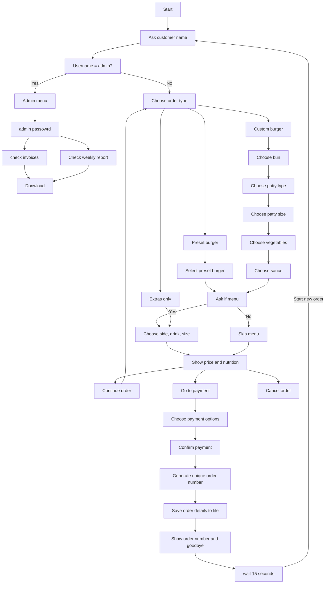

# Best burger
### A project made by Group-H from FHNW
## 💡 Idea
Our Idea stems from the desire to create the Best Burger to satisfy every type of dietary requirement. 

To do this, we’ve developed this program where customers can choose to build their own burger from scratch or select one of the options we’ve already created.

Customers can choose to pair the burger with a side dish and a drink to create a meal, or purchase just the burger. Once they have made their selection, they will see the nutritional information and price before proceeding to checkout.

##📝 Analysis

### 🤔 problem
People who love burgers (who) experience long queues and waiting times (what) during the ordering process of custom burger at the casheer (where), resulting in frustrated customers/employees and higher percentage risk of mistakes (why).

##💡 Scenario
Best Burger solves the part of the problem of frustrated customers/employees and high percentage risk of mistakes by letting a user create their own custom burger with a defined list of ingredients and automatically calculate the total and generate the invoice. 

### 👤 User Roles
| Role | Description |
|------|-------------|
| **Customer** | Orders burgers and wants to know what they have ordered, how much they need to pay and nutritional values of the order. |
| **Owner** | Runs the Burger shop, maintains the menu, keeps records of all sales and checks weekly reports. |

## 👥 User stories:

#### US-1: Title @Filippo Paccagnella
1. As a customer, I want to be able to customize a burger to satisfy my taste, allergies and dietary requirements. 

**Acceptance criteria:**
- The list of buns (with price and calories) will be displayed when the customer selects option 1 ("Create a Custom Burger") in the main menu.
- The list of patties (with price and calories) will be displayed after the customer choose the buns.
- The list of cheese (with price and calories) will be displayed after the customer choose the patties.
- The list of vegetables (with price and calories) will be displayed after the customer choose the cheese.
- The list of sauces (with price and calories) will be displayed after the customer choose the vegetables.
- After the choice of the sauce a recap of all the ingredients will be shown to the customer.
---
#### US-2: Title @Filippo Paccagnella
2. As a customer, I want to order a Preset burger to have a faster meal and try the chef's ideas. 

**Acceptance criteria:**
- The list of Preset Burger (with price and calories) will be displayed when the customer selects option 2 ("Choose a preset Burger") in the main menu.
---
#### US-3: Title @Filippo Paccagnella
3. As a customer, I want the possibility to order extras/sides and drinks to create a menu to get a full meal plan. 

**Acceptance criteria:**
-  After the choice of Custom or Preset burger the customer need to choose if they want to make a menu or not.
-  If the Customer choose "yes" the list of available Sides/Extra (with price and calories) will be shown to them.
-  After they choose they need to say if they want also a drink or not.
-  If they answer yes the list of available drink (with price and calories) will be shown to them.
-  After they select their option a recap of the order will be shown to them.
---
#### US-4: Group order @Andrei Parnia
4. As a customer, I want to be able to be able to order for an entire group, so the ordering is fast.

**Acceptence criteria:**
- TBD
---
#### US-5: Current costs @Andrei Oros
5. As a customer, I want to see the current subtotal with VAT included after every decision at every step of the order.

**Acceptance criteria:**
- TBD
---
#### US-6: Nutritional values and allergens @Andrei Parnia
6. As a customer, I want to know the  nutritional values and allergens of my selected products.

**Acceptance criteria:**
- TBD
---
#### US-7: Costs and Taxes @Andrei Oros
7. As a customer, I want to see the Final Order, the Total Cost, the Subtotal, the VAT rate, and VAT amount before confirming the Order, to make sure I have ordered everything right.

**Acceptance criteria:**
- TBD
---
#### US-8: Discounts for Students @Andrei Oros
7. As a customer, I expect to be asked if I am a student, and receive a 10% discount before confirming the order and check-out, to profit from my social status.

**Acceptance criteria:**
- While the Final Order is shown, 
---
#### US-9: Payment Methods @Andrei Oros
7. As a customer, after confirming the order I want to have different payment options (cash or card), so that I can pay with the method of my choice.

**Acceptance criteria:**
- TBD
---

#### US-10: Receiving an Invoice @Andrei Oros
8. As a customer, after the payment is succesful I want to receive a printed invoice with the order number and all the details so I can pickup the order, and for tax purposes.

**Acceptance criteria:**
- After the payment is accepted, the details of the order are written to a new .txt file stored in the orders folder, so that the customer gets a printed copy and the order gets processed.
- The invoice file is created, it is named by the date and the order number, so they can be filtered by date and have unique series.
- The invoice saves the following details: business location, date of the order, client name, order number, items per piece ordered with their respective cost and VAT rate,
  the total nutritional value, alergens contained, subtotal and total cost, payment method, and a good bye message, so that the customer has a clear record of it's purchase.
- After the creation of the invoice files, they should be accesible by the Administrator, so that they can be used for further processes
---
#### US-11: Admin menu @Andrei Parnia
9. As an owner, I want to have an admin panel, where I can check the previous orders, and get a weekly sales report so I can take data driven decisions on existing and new products.

**Acceptance criteria:**
- At the greeting screen, when the user is asked for the name, entering `Admin` will open a new menu that is locked behind a passowrd.
- In the admin menu, the owner of the restaurant can see the past invoices.
- In the admin menu, the owner can see a weekly report with the exact products that were sold and income generated per week (in `CHF`)
- In the admin menu, the owner can see the balance of the stock of all items, t know when needs to order more, and which.


## 🚧 Structure


## Function tree

```text
best_burger/
├── main.py
├── menu_data.py
├── calculators.py
├── order.py
├── data/
│   ├── ingredients.csv
│   ├── preset_burgers.csv
│   ├── sides.csv
│   ├── drinks.csv
│   └── orders.csv
└── README.md
```

## how it works
1. The program starts by asking for the customer's name. Then the customer chooses between a preset burger, a custom burger, or extras only.
    1.1. The owner will have a dedicated name that will open the admin side of the program.
    1.2. The owner can access the recipes or weekdly sales reports

2. For preset burgers, the customer selects one of the available burgers and can add a menu with sides and a drink.

3. For custom burgers, the customer chooses the bun, patty, patty size, vegetables, and sauce. After that, they can add sides and a drink.

4. Before finishing, the program shows the total price and nutritional values. The customer can continue ordering, cancel the order, or choose a payment method. After the payment method is selected, the program generates a unique order number and saves the order details to a file.

